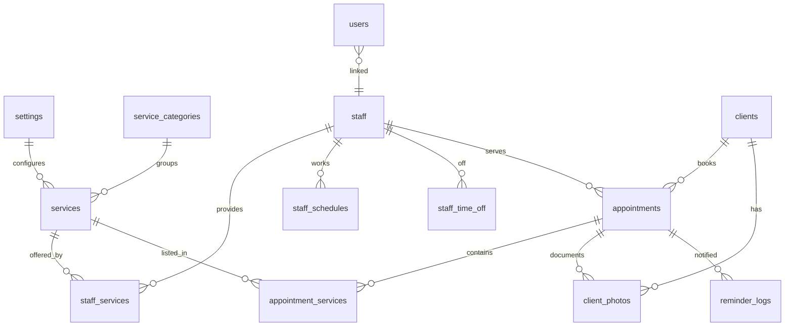

# وثيقة البناء التقنية: نظام حجز صالونات التجميل

> جاهزة للتنفيذ. Laravel + Livewire/Blade + MySQL. Single-tenant. RTL/عربي. بدون فوترة.
> الأنواع والمعرّفات بالإنجليزية (كود)، الشرح بالعربية.

---

## القسم الأول: قاعدة البيانات

### مخطط العلاقات (ER)



### الجداول (build-ready)

#### settings — سجل واحد فقط (بيانات الصالون)
| column | type | null | notes |
|---|---|---|---|
| id | unsignedBigInt PK | no | |
| salon_name | string(150) | no | |
| logo | string(255) | yes | مسار الصورة |
| primary_color | string(7) | yes | hex مثل 1E88E5# |
| currency | enum('SAR','AED') | no | افتراضي SAR |
| timezone | string(50) | no | Asia/Riyadh |
| week_start | tinyInt | no | 0=الأحد |
| phone | string(20) | yes | |
| whatsapp_number | string(20) | yes | رقم الصالون للتذكير |
| address | string(255) | yes | |
| working_hours | json | no | {"0":{"open":"10:00","close":"22:00","closed":false}, ...} |
| reminder_template | text | yes | نص رسالة الواتساب بمتغيرات |
| license_domain | string(150) | yes | للحماية |
| timestamps | | | |

#### service_categories
| column | type | null | notes |
|---|---|---|---|
| id | PK | no | |
| name | string(100) | no | |
| sort_order | int | no | افتراضي 0 |
| is_active | boolean | no | افتراضي true |
| timestamps | | | |

#### services
| column | type | null | notes |
|---|---|---|---|
| id | PK | no | |
| category_id | FK→service_categories | yes | onDelete set null |
| name | string(150) | no | |
| duration_minutes | unsignedSmallInt | no | مدة الخدمة |
| price | decimal(8,2) | no | |
| description | text | yes | |
| color | string(7) | yes | للتقويم |
| is_active | boolean | no | افتراضي true |
| timestamps | | | |
| index | | | (is_active), (category_id) |

#### staff
| column | type | null | notes |
|---|---|---|---|
| id | PK | no | |
| name | string(120) | no | |
| phone | string(20) | yes | |
| photo | string(255) | yes | |
| bio | text | yes | |
| commission_percent | decimal(5,2) | no | افتراضي 0 |
| is_active | boolean | no | افتراضي true |
| timestamps | | | |

#### staff_services — many-to-many
| column | type | null | notes |
|---|---|---|---|
| staff_id | FK→staff | no | onDelete cascade |
| service_id | FK→services | no | onDelete cascade |
| | | | PK مركّب (staff_id, service_id) |

#### staff_schedules — الدوام الأسبوعي
| column | type | null | notes |
|---|---|---|---|
| id | PK | no | |
| staff_id | FK→staff | no | cascade |
| weekday | tinyInt | no | 0=الأحد .. 6=السبت |
| start_time | time | no | |
| end_time | time | no | |
| is_off | boolean | no | يوم راحة أسبوعي |
| | | | unique (staff_id, weekday) |

#### staff_time_off — إجازات/غياب بتاريخ محدد
| column | type | null | notes |
|---|---|---|---|
| id | PK | no | |
| staff_id | FK→staff | no | cascade |
| date | date | no | |
| start_time | time | yes | فارغ = يوم كامل |
| end_time | time | yes | |
| reason | string(150) | yes | |
| | | | index (staff_id, date) |

#### clients
| column | type | null | notes |
|---|---|---|---|
| id | PK | no | |
| name | string(120) | no | |
| phone | string(20) | no | **unique** — المعرّف الأساسي |
| email | string(150) | yes | |
| birthdate | date | yes | لعروض عيد الميلاد لاحقاً |
| skin_type | string(50) | yes | حقل تجميلي |
| hair_type | string(50) | yes | حقل تجميلي |
| notes | text | yes | ملاحظات الأخصائية |
| tags | json | yes | ["VIP","حساسية"] |
| timestamps | | | |
| index | | | unique(phone) |

#### client_photos — قبل/بعد
| column | type | null | notes |
|---|---|---|---|
| id | PK | no | |
| client_id | FK→clients | no | cascade |
| appointment_id | FK→appointments | yes | set null |
| type | enum('before','after') | no | |
| image_path | string(255) | no | |
| note | string(255) | yes | |
| taken_at | datetime | no | |
| index | | | (client_id) |

#### appointments — الجدول المحوري
| column | type | null | notes |
|---|---|---|---|
| id | PK | no | |
| client_id | FK→clients | no | restrict |
| staff_id | FK→staff | no | restrict |
| datetime_start | datetime | no | |
| datetime_end | datetime | no | يُحسب = start + مجموع مدد الخدمات |
| status | enum('pending','confirmed','completed','cancelled','no_show') | no | افتراضي pending |
| source | enum('online','manual') | no | افتراضي manual |
| price_snapshot | decimal(8,2) | no | إجمالي وقت الحجز |
| notes | text | yes | |
| timestamps | | | |
| index | | | (staff_id, datetime_start), (client_id), (status) |

#### appointment_services — خدمات الموعد (قد تكون أكثر من واحدة)
| column | type | null | notes |
|---|---|---|---|
| id | PK | no | |
| appointment_id | FK→appointments | no | cascade |
| service_id | FK→services | no | restrict |
| price | decimal(8,2) | no | snapshot |
| duration_minutes | unsignedSmallInt | no | snapshot |

#### users — دخول اللوحة
| column | type | null | notes |
|---|---|---|---|
| id | PK | no | |
| name | string(120) | no | |
| email | string(150) | no | unique |
| password | string | no | hashed |
| role | enum('admin','staff') | no | |
| staff_id | FK→staff | yes | لو الحساب لموظفة |
| timestamps | | | |

#### reminder_logs — اختياري
| column | type | null | notes |
|---|---|---|---|
| id | PK | no | |
| appointment_id | FK→appointments | no | cascade |
| channel | enum('whatsapp','email') | no | |
| sent_at | datetime | no | |
| sent_by | FK→users | yes | |

> **ملاحظة مهمة:** منع تعارض المواعيد يُدار في **طبقة التطبيق** (خوارزمية التوفّر) لا في قيد DB، لأن المدة متغيّرة. استخدمي transaction + قفل عند إنشاء الموعد لتفادي الحجز المزدوج المتزامن.

---

## القسم الثاني: الشاشات + الوظائف

> لكل شاشة: الغرض، الأقسام، الأفعال ومنطقها، المدخلات والتحقق، ما تقرأه/تكتبه.

### أ. واجهة العميلة (عامة، RTL، جوال-أول)

#### 1. صفحة الحجز `/book`
- **الغرض:** حجز موعد بلا تسجيل دخول.
- **الخطوات (wizard):**
  1. **اختيار الخدمة/الخدمات:** تُعرض من `services` حيث `is_active` مجمّعة بالأقسام. عند اختيار أكثر من خدمة تُجمع المدد.
  2. **اختيار الموظفة:** تُعرض `staff` النشطات اللواتي يقدّمن كل الخدمات المختارة (join عبر `staff_services`) + خيار "أي موظفة متاحة".
  3. **اختيار اليوم والوقت:** تقويم يعرض الأيام، وعند اختيار يوم تُستدعى **خوارزمية التوفّر** (القسم الثالث) وتُعرض الأوقات المتاحة فقط.
  4. **بيانات العميلة:** الاسم + الجوال (وema اختياري). لو الجوال موجود في `clients` تُربط، وإلا يُنشأ سجل جديد.
  5. **تأكيد.**
- **التحقق:** الجوال بصيغة +966/+971 صحيحة؛ الوقت ما زال متاحاً لحظة الإرسال (إعادة فحص داخل transaction).
- **الكتابة:** إنشاء `appointment` (source=online, status=pending) + `appointment_services` + إنشاء/ربط `client`.
- **بعد الحفظ:** صفحة تأكيد + رابط "أضيفي للتقويم" (.ics) + رقم واتساب الصالون.

#### 2. صفحة تأكيد `/book/confirmed/{id}`
- عرض ملخص الموعد + زر واتساب للصالون.

#### 3. متابعة موعدي `/my-booking`
- إدخال الجوال → عرض مواعيد العميلة القادمة → إمكانية **الإلغاء** (يحدّث status=cancelled ضمن سياسة وقت مسموح).

### ب. لوحة الإدارة (خلف auth)

#### 4. تسجيل الدخول `/admin/login`
- مصادقة عبر `users`؛ توجيه حسب الدور. الموظفة ترى مواعيدها فقط، الـ admin يرى الكل.

#### 5. اللوحة الرئيسية `/admin`
- **بطاقات:** عدد مواعيد اليوم، الإيراد المتوقع اليوم (Σ price_snapshot للمواعيد غير الملغاة)، المواعيد الفائتة (no_show)، القادم التالي.
- **قائمة مواعيد اليوم** مرتّبة زمنياً مع حالة كل موعد.

#### 6. التقويم `/admin/calendar`
- عرض **يومي/أسبوعي**؛ كل موعد block بلون خدمته/حالته.
- **أفعال:** سحب/إفلات لإعادة الجدولة (يعيد فحص التوفّر)، نقر لفتح الموعد، إنشاء موعد يدوي من خانة فارغة.

#### 7. المواعيد `/admin/appointments`
- **جدول** بفلترة: الحالة، التاريخ (من/إلى)، الموظفة، بحث بجوال العميلة.
- **أفعال لكل صف:** تغيير الحالة (confirmed/completed/cancelled/no_show) بضغطة، **إرسال تذكير واتساب** (يولّد رابط wa.me + يسجّل في reminder_logs)، تعديل، حذف.
- **إنشاء موعد يدوي:** نفس منطق الحجز لكن من طرف الموظفة (source=manual).

#### 8. العميلات `/admin/clients` + الملف `/admin/clients/{id}`
- **القائمة:** بحث بالاسم/الجوال، عدد الزيارات، آخر زيارة.
- **الملف:** البيانات + الحقول التجميلية (skin_type, hair_type, notes, tags)، **تاريخ المواعيد**، **معرض صور قبل/بعد** (رفع صورة، ربطها بموعد، تصنيف before/after)، **إجمالي الإنفاق** (Σ price_snapshot للمكتملة).

#### 9. الخدمات `/admin/services`
- CRUD للأقسام و الخدمات (اسم، مدة، سعر، لون، تفعيل). سحب لإعادة ترتيب الأقسام.

#### 10. الموظفات `/admin/staff` + `/admin/staff/{id}`
- CRUD للموظفة، **ربط الخدمات** التي تقدّمها (staff_services)، **الجدول الأسبوعي** (staff_schedules لكل يوم)، **الإجازات** (staff_time_off)، نسبة العمولة.

#### 11. التقارير `/admin/reports`
- أكثر الخدمات طلباً (count عبر appointment_services)، أداء الموظفات (عدد/إيراد المكتمل)، **عمولة كل موظفة** = commission_percent × Σ خدماتها المكتملة، المواعيد الفائتة، فلترة بفترة زمنية.

#### 12. الإعدادات `/admin/settings`
- تعديل `settings`: الشعار، اللون، ساعات العمل (لكل يوم)، العملة، رقم واتساب، نص قالب التذكير.

---

## القسم الثالث: خريطة الـ Routes

**عامة:** `GET /book`، `POST /book` (إنشاء)، `GET /book/confirmed/{id}`، `GET /my-booking`، `POST /my-booking/cancel`.
**API داخلي للحجز:** `GET /api/available-slots?service_ids=&staff_id=&date=` → يرجع الأوقات المتاحة.
**إدارة:** `GET/POST /admin/login`، `POST /admin/logout`، `GET /admin` (dashboard)، resource routes لـ `appointments, clients, services, service-categories, staff`، `GET /admin/calendar`، `GET /admin/reports`، `GET/PUT /admin/settings`، `POST /admin/appointments/{id}/reminder`، `POST /admin/appointments/{id}/status`، `POST /admin/clients/{id}/photos`.

---

## القسم الرابع: خوارزمية الأوقات المتاحة (الجزء الأصعب)

**المدخلات:** قائمة الخدمات (منها المدة الكلية D)، الموظفة S (أو "أي")، التاريخ date.

```
1. حدّد weekday من date.
2. أحضر ساعات عمل الصالون لذلك اليوم من settings.working_hours (لو مغلق → لا أوقات).
3. لكل موظفة مرشّحة (لو S محددة فهي فقط؛ لو "أي" فكل staff نشطة تقدّم كل الخدمات):
   a. أحضر staff_schedules[weekday]؛ لو is_off → تخطَّ.
   b. حدّد نافذة العمل = تقاطع (ساعات الصالون ∩ دوام الموظفة).
   c. اطرح فترات staff_time_off لهذا التاريخ من النافذة.
   d. أحضر مواعيد الموظفة في هذا التاريخ (status ∉ cancelled) كفترات مشغولة [start,end].
   e. ولّد أوقات بداية مرشّحة من نافذة العمل بخطوة step (مثلاً 15 دقيقة):
        candidate = [t, t + D]
        صالح إذا: t+D ≤ نهاية النافذة  و  candidate لا يتقاطع أي فترة مشغولة
        و t في المستقبل + buffer (مثلاً بعد ساعة من الآن).
4. لو S = "أي": الوقت متاح إذا توفّرت ≥ موظفة واحدة؛ خزّن أول موظفة متاحة لكل وقت.
5. أرجع قائمة الأوقات المتاحة (مع الموظفة المقترحة لكل وقت).
```

**عند تأكيد الحجز:** افتح DB transaction، أعد فحص أن [start, start+D] ما زال حراً لتلك الموظفة (SELECT ... مع lock)، ثم أنشئ الموعد. هذا يمنع الحجز المزدوج المتزامن.

**تعارض فترتين** يتحقق بالقاعدة: `A.start < B.end AND B.start < A.end`.

---

## نقطة انطلاق مقترحة (اليوم)
1. أنشئي مشروع Laravel + كل الـ migrations أعلاه + seeders لبيانات تجريبية (صالون، خدمات، موظفتان بجدولين).
2. اكتبي خدمة `AvailabilityService` بخوارزمية القسم الرابع + اختبار وحدة لها (هي قلب النظام).
3. ابني صفحة الحجز العامة فوقها.
